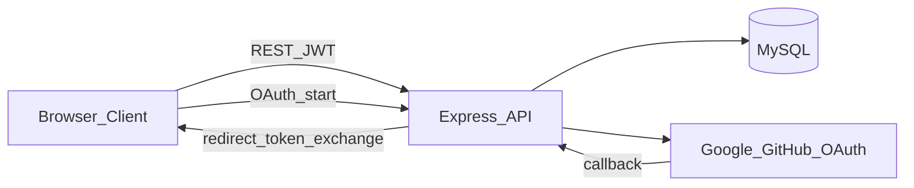
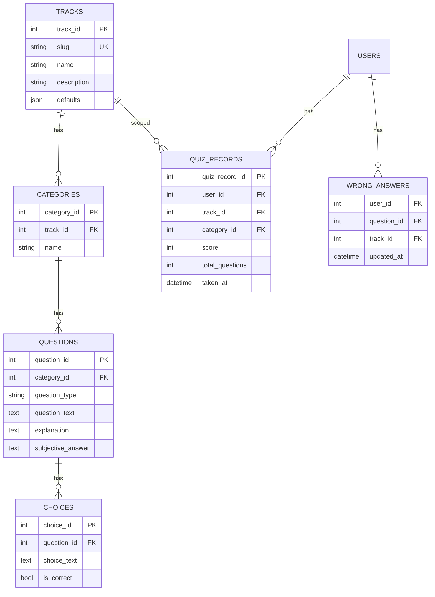
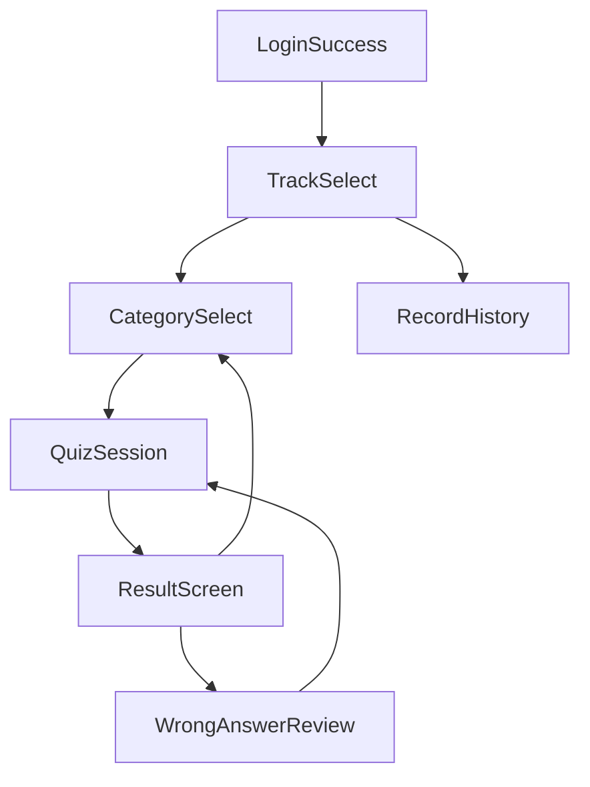

# Architecture

멀티 트랙 퀴즈 학습 플랫폼의 목표 아키텍처와 현재(As-Is) 상태를 정리한다.

## 제품 포지션

**하나의 퀴즈 학습 엔진** 위에 여러 **학습 트랙(Track)** 을 올린다.

| 구분 | 설명 |
|------|------|
| 공통 | 풀이, 타이머, 오답 노트, 학습 기록, (향후) 관리자 콘텐츠 운영 |
| 트랙별 | 카테고리·문제 콘텐츠, 트랙 메타(기본 문항 수, 문제당 제한 시간 등) |

**1차 트랙:** CS Interview, 정보처리기사  
**확장 트랙:** SQLP, AWS 등 — 동일 스키마·플로우로 추가

---

## 시스템 컨텍스트



| 레이어 | 기술 | 위치 |
|--------|------|------|
| Client | React 19, Vite, TypeScript, Axios | `client/` |
| API | Express 5, TypeScript, Passport, JWT | `server/src/` |
| DB | MySQL (mysql2 pool) | `server/src/config/db.ts` |
| 배포 | GitHub Actions SSH + pm2 | `.github/workflows/deploy.yml` |

레포는 **client / server 이중 패키지** 구조이며, 루트 workspace monorepo는 사용하지 않는다.

---

## As-Is (현재 구현)

### 백엔드

- **라우팅:** `routes → controllers → services → models → MySQL`
- **마운트:** `/api/quiz`, `/api/auth`, `/api/system` (`server/src/index.ts`)
- **퀴즈 API:** 카테고리 전체 조회, `categoryIds` 기준 랜덤 출제, choices 일괄 조회
- **기록 API:** JWT 보호 `GET|POST|DELETE /api/quiz/records` (클라이언트 미연동)
- **인증:** Google/GitHub OAuth → JWT 발급 → 클라이언트 URL로 `?token=` 리다이렉트
- **역할:** `ADMIN` 상수만 존재, 라우트 가드 없음

### 프론트엔드

- 단일 SPA (`App.tsx`), React Router 없음
- `useQuiz` 훅: 로딩 → 퀴즈 → 결과, 30초 타이머, localStorage 오답 ID
- 시작 시 **모든 카테고리 ID**를 가져와 전체 혼합 출제
- `CategoryFilter` 컴포넌트는 미연결

### 데이터 (추정 스키마)

```
categories → questions → choices
users, quiz_records
```

`quiz_submissions` 테이블명은 코드 상수에만 있고 미사용.

### As-Is 갭 (알려진 이슈)

| 영역 | 내용 |
|------|------|
| 도메인 | Track 계층 없음 → CS/자격증 카테고리 혼재 가능 |
| UX | 트랙·카테고리 선택, 로그인 성공, 기록 UI 없음 |
| 오답 복습 | 현재 세션에 로드된 문제만 필터 (`useQuiz.handleReviewWrongAnswers`) |
| API | 응답에 `isCorrect`, `subjectiveAnswer` 포함 → 클라이언트 채점 |
| 버그 | `GET_QUIZ_RECORDS_BY_CURSOR` SQL 괄호 누락, `error.mesage` 오타 |
| 저장소 | `client/src/api/axiosClient.ts`가 `.gitignore` 대상 |
| 문서 | README와 실제 env·기능 불일치 |

---

## To-Be (목표 아키텍처)

### 도메인 모델



**설계 결정**

- `tracks.slug`: `cs-interview`, `engineer-ipe`, `sqlp`, `aws-saa` 등 URL·API 식별자
- `tracks.defaults` 예:
  - IPE: `{ "questionLimit": 10, "secondsPerQuestion": 30, "passRule": { "minPerCategory": 40, "minAverage": 60 } }`
  - SQLP: `{ ..., "passRule": { "minPerCategory": 40, "minOverall": 75 } }`
  - `passRule`은 선택. Exam submit 시 과목별 100점 환산·`average`·`overall`·`passed`에 사용
  - `minAverage`: 과목 점수 산술 평균 (정보처리기사 필기)
  - `minOverall`: 세션 전체 정답률 × 100 (SQLP 필기 총점; 실기 서술형은 미시뮬)
- `categories.track_id`: 트랙별 카테고리 격리. 마이그레이션 시 기존 row는 기본 트랙(예: `cs-interview`)에 귀속
- `quiz_records.track_id`: 트랙별 약점·이력 분석
- **게스트:** localStorage 오답 ID (키는 트랙 slug 포함 권장)
- **로그인 사용자:** `wrong_answers` 테이블과 동기화(로그인 시 merge, 이후 서버 우선)
- `quiz_submissions`: Phase 6(Exam·서버 채점)에서 문항별 제출 저장에 사용하거나, 미사용 시 상수·테이블 정리

### 학습 모드

| 모드 | 동작 | 채점·정답 |
|------|------|-----------|
| **Practice** | 트랙 → 카테고리 선택 → 타이머 → 즉시 해설 | 클라이언트 즉시 피드백 허용 (학습 UX) |
| **Review** | 저장된 오답 ID로 API 재조회 후 Practice와 동일 | 동일 |
| **Exam** | 학습용 시뮬: `문항수 × secondsPerQuestion` 전체 타이머, 해설 지연 | 서버 `POST /api/quiz/exam/submit` 채점; 출제 시 정답 미포함; `passRule` 있으면 과목별 점수·합격 판정 |

**Exam 범위 (학습 시뮬)**

- 타이머는 트랙 `defaults.secondsPerQuestion` 기반. 공식 시험 시간표(과목당 30분 등)·과목당 고정 문항 수는 **미구현**
- 합격 규칙은 트랙 `defaults.passRule`이 있을 때만 적용 (`passed: null`이면 점수만 표시)

**보안 원칙**

- 공식 **점수·랭킹·DB 기록**은 서버 채점 API 결과만 신뢰한다.
- Practice/Review는 개인 학습용으로 정답 필드 노출을 허용할 수 있다.
- Exam 모드는 출제 API에서 정답 제외 + `POST /api/quiz/exam/submit`으로 채점한다.

### API 경계 (목표)

기존 `/api/quiz`를 확장하고 트랙 리소스를 분리한다.

| Method | Path | 설명 | 인증 |
|--------|------|------|------|
| GET | `/api/tracks` | 활성 트랙 목록 | - |
| GET | `/api/tracks/:slug/categories` | 트랙별 카테고리 | - |
| GET | `/api/quiz/quizzes` | `track`, `categoryIds`, `limit` 출제 | - |
| GET | `/api/quiz/questions` | `ids` — 오답 복습용 재조회 | - |
| GET | `/api/quiz/records` | 커서/최근 기록, `trackId` 필터 | JWT |
| POST | `/api/quiz/records` | 세션 결과 저장, `trackId` 필수 | JWT |
| DELETE | `/api/quiz/records` | 기록 삭제 | JWT |
| GET | `/api/auth/google`, `/github` | OAuth 시작 | - |
| GET | `/api/auth/*/callback` | OAuth 콜백 | - |
| POST | `/api/auth/logout` | (등록 예정) | JWT |
| GET/POST/PATCH/DELETE | `/api/admin/...` | 트랙·카테고리·문제 CRUD | JWT + ADMIN |

**인증 목표**

- OAuth 콜백 후 JWT를 URL 쿼리에 장기 노출하지 않는다.
- 목표: **일회용 코드 교환** 또는 **HttpOnly Secure 쿠키** + CSRF 대책(SameSite 등).
- 리다이렉트 base URL은 환경별 `CORS_ORIGIN_*` 중 요청 Origin에 맞게 선택.

### 프론트 구조 (목표)



| 관심사 | 담당 (목표) |
|--------|-------------|
| 라우팅 | React Router — `/`, `/tracks/:slug`, `/quiz`, `/login/success`, `/history` |
| 세션 상태 | `useQuiz` — 문항 인덱스, 타이머, 채점 UI, 결과 |
| 트랙·카테고리 | `useTrackSelection` 또는 페이지 레벨 state |
| API | `quizApi`, `trackApi`, `authApi`, `recordApi` |
| 스타일 | 현행 CSS 유지. `CategoryFilter`는 CategorySelect로 흡수·프로젝트 CSS에 맞게 수정 |

### 타입 공유 (목표)

단기: client/server 타입 필드명 통일 (`category_id` ↔ `categoryId` 매핑 계층을 service 한곳에).  
중기: `packages/shared-types` 또는 OpenAPI 생성 타입으로 중복 제거.

---

## 디렉터리 규칙 (목표)

```
server/src/
  routes/       HTTP 경로
  controllers/  req/res, status code
  services/     비즈니스 규칙, DTO 변환
  models/       SQL, Row 타입
  middlewares/  auth, admin
  types/

client/src/
  pages/        TrackSelect, CategorySelect, Quiz, ...
  components/   QuizCard, ProgressBar, ...
  hooks/        useQuiz, ...
  api/
  types/
```

---

## 환경 변수 (참고)

**Server** (`server/.env`)

| 변수 | 용도 |
|------|------|
| `PORT` | API 포트 |
| `DB_HOST`, `DB_PORT`, `DB_NAME` | MySQL |
| `DB_USER_DEV`, `DB_PASSWORD_DEV` | DB 계정 |
| `JWT_SECRET` | JWT 서명 |
| `CORS_ORIGIN_*` | 허용 Origin 목록 |
| `GOOGLE_*`, `GITHUB_*` | OAuth |

**Client** (`client/.env`)

| 변수 | 용도 |
|------|------|
| `VITE_PORT`, `VITE_ALLOW_HOST*` | Vite dev server |
| `VITE_QUIZ_API_BASE_URL` | API 베이스 URL (`axiosClient`) |

---

## 관련 문서

- [ROADMAP.md](./ROADMAP.md) — 구현 단계 및 완료 조건
- [README.md](../README.md) — 실행 방법 및 기능 요약
